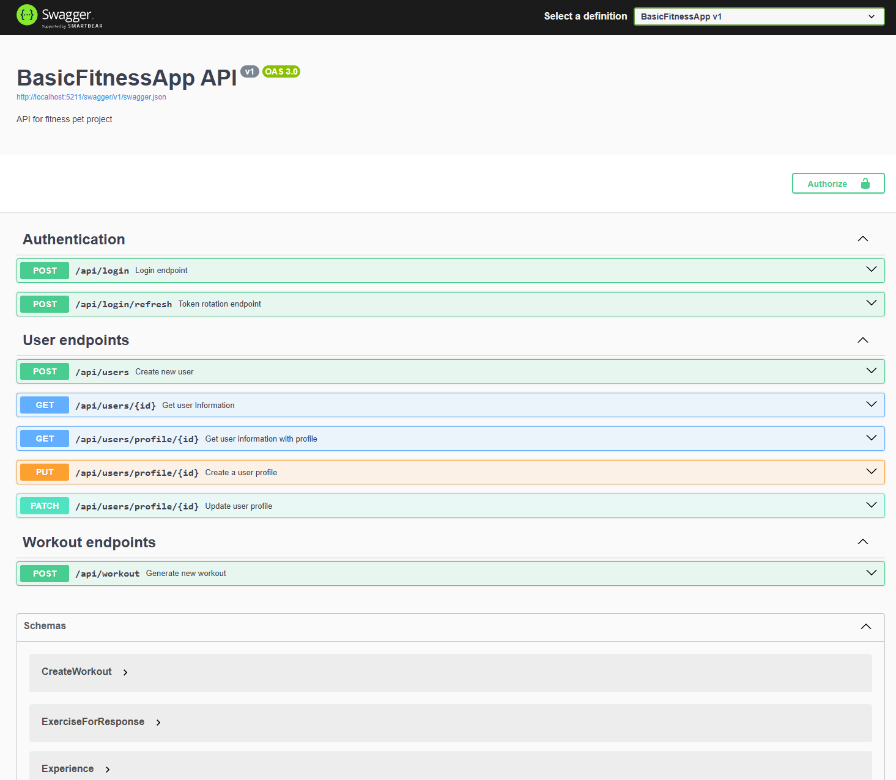
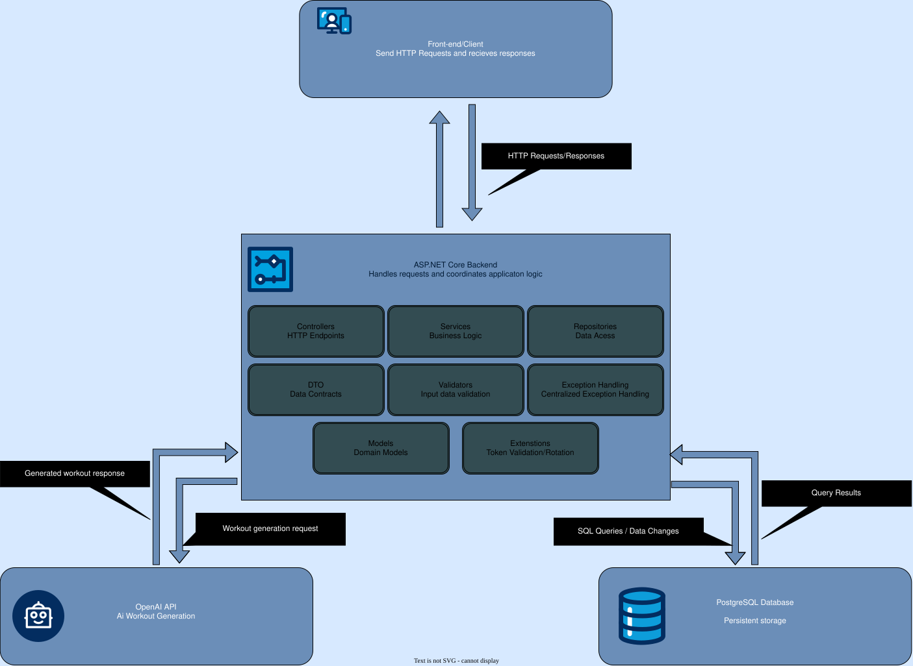

# Basic Fitness-App

Workouts Managment API

A RESTful backend application for managing user profiles, authentication and personalized workout generation.

## Overview

Fitness-App is a backend application built with ASP.NET Core.

It provides auser authentication, profile managment and workout generatio using OpenAi integration.

## Features

- User registration and authentication.
- JWT-based authentication.
- Refresh token management.
- User profile management.
- Database persistence with EF Core.
- AI-powered workout generation.
- Centralized exception handling.
- Request validation.

## Architecture

## Tech Stack

| Category | Technologies |
|:---:|:---:|
| Language | C# |
| Framework | ASP.NET Core  |
| Database | PostgreSQL |
| ORM | Entity Framework Core |
| Integration | REST API, OpenAI API |
| Logging | Serilog |
| Deployment | Docker, Docker Compose |

