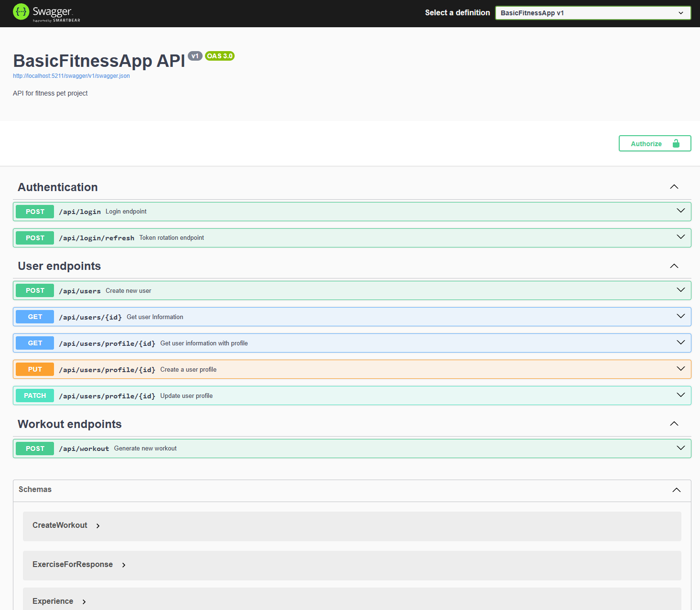
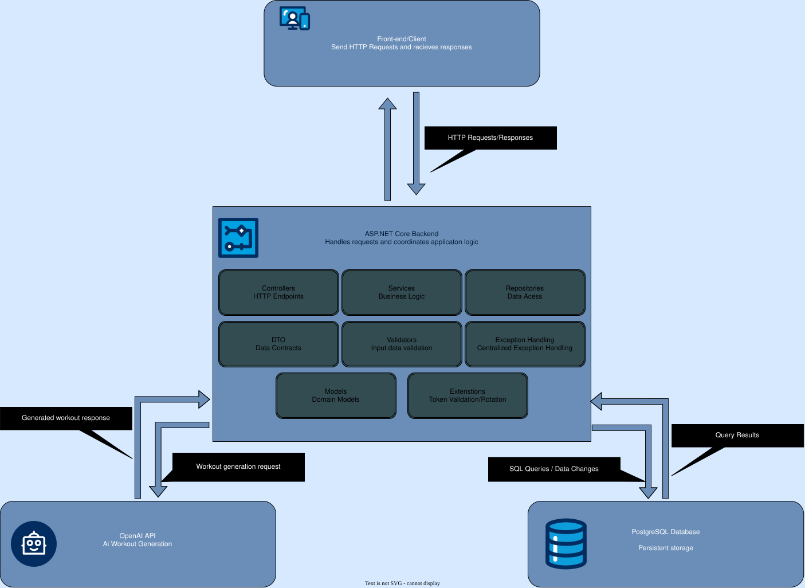

# Basic Fitness-App

Workouts Managment API



A RESTful backend application for managing user profiles, authentication and personalized workout generation.


## Overview

Fitness-App is a backend application built with ASP.NET Core.

It provides user authentication, profile managment and workout generatio using OpenAi integration.

## Features

- User registration and authentication.
- JWT-based authentication.
- Refresh token management.
- User profile management.
- Database persistence with EF Core.
- AI-powered workout generation.
- Centralized exception handling.
- Request validation.

## Architecture



## Tech Stack

| Category | Technologies |
|:---:|:---:|
| Language | C# |
| Framework | ASP.NET Core |
| Authentication | JWT Bearer |
| Validation | Fluent Validation |
| Database | PostgreSQL |
| ORM | Entity Framework Core |
| Integration | REST API, OpenAI API |
| API Documentation | Swagger |
| Logging | Serilog |
| Deployment | Docker, Docker Compose |

## Get Started 

```bash
git clone https://github.com/Papa-Suharik/BasicFitnessApp.git
cd BasicFitnessApp
```
Configure your environment variables and database connection, then run:

```bash
dotnet restore
dotnet ef database update
dotnet run
```

### Configuration

| Variable | Description |
|:---|:---:|
| `OPEN_AI_APIKEY` | API Key to external OpenAI language model |
| `JWT_KEY` | Unqie Key used to sign the JWT|
| `JWT_ISSUER` | Identifies who created and signed the JWT |
| `JWT_AUDIENCE` | Identifies who means to accept the JWT |
| `JWT_EXPIRATION_MINUTES` | Identifies lifetime of the JWT |
| `DB_HOST` | PostgreSQL database host |
| `DB_PORT` | PostgreSQL database port |
| `DB_NAME` | PostgreSQL database name |
| `DB_USER` | PostgreSQL database username |
| `DB_PASSWORD` | PostgreSQL database password |

## Deployment

The application can be containerized and deployed using Docker Compose.


